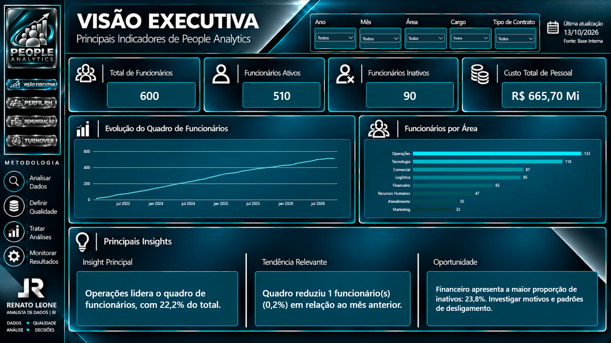
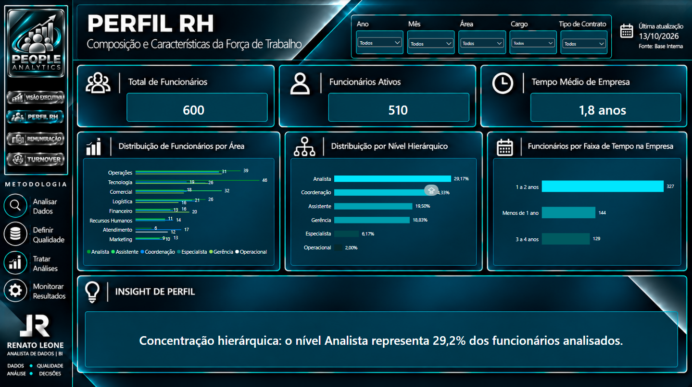
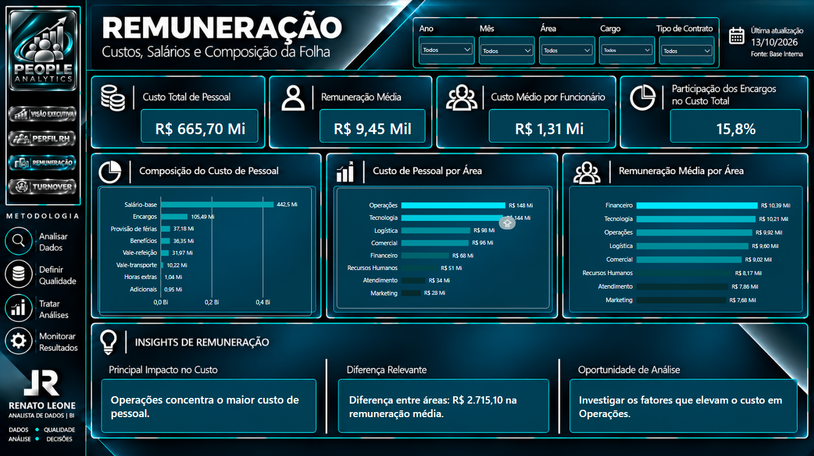
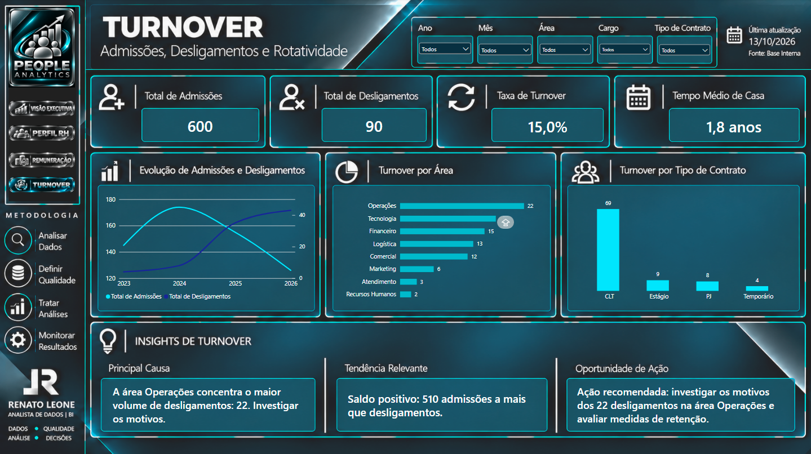

 <div align="center">

# PEOPLE ANALYTICS RH

### Human Resources · Workforce · Compensation · Turnover

<p align="center">
  
  
  
  
  
  
  
</p>

**Análise de dados de Recursos Humanos para explorar indicadores de pessoas e apoiar decisões de gestão.**

</div>

---

## Visão geral do projeto



O **People Analytics RH** é um laboratório de análise de dados desenvolvido para praticar um fluxo de trabalho de ponta a ponta em Análise de Dados e Business Intelligence aplicado ao contexto de Recursos Humanos.

O projeto integra preparação e validação de dados com Python, armazenamento e consultas no PostgreSQL, análise com SQL, modelagem e indicadores com DAX e visualização no Power BI.

> **Natureza do projeto:** laboratório educacional com dados fictícios e indicadores simulados. Os resultados não representam uma empresa real.

## Dashboards

### 01 · Visão Executiva

Visão consolidada dos principais indicadores do cenário simulado de Recursos Humanos.


### 02 · Perfil RH

Exploração do perfil dos colaboradores, distribuição organizacional e tempo de empresa.



### 03 · Remuneração

Análise dos custos de pessoal, composição remuneratória e indicadores relacionados à remuneração.



### 04 · Turnover

Análise das movimentações simuladas de pessoal, incluindo admissões, desligamentos e indicadores de rotatividade.



## Problema de negócio e objetivos

Em um cenário fictício de Recursos Humanos, a gestão precisa acompanhar a composição do quadro de funcionários, o perfil dos colaboradores, os custos de remuneração e as movimentações de pessoal.

**Objetivos do laboratório:**

- Analisar a composição e evolução do quadro de funcionários.
- Explorar a distribuição de colaboradores por área, cargo e nível.
- Investigar indicadores de remuneração.
- Analisar admissões e desligamentos.
- Desenvolver consultas analíticas e indicadores.
- Comunicar resultados por meio de dashboards.

## Dados utilizados

O projeto utiliza uma base sintética desenvolvida para fins educacionais.

| Conjunto de dados | Finalidade |
|---|---|
| `funcionarios` | Cadastro e características dos colaboradores fictícios |
| `eventos_rh` | Eventos simulados de admissão e desligamento |
| `historico_quadro_mensal` | Histórico mensal do quadro de funcionários |
| `historico_remuneracao` | Histórico mensal dos componentes remuneratórios |
| `dim_calendario` | Referência temporal |
| `dim_area` | Classificação das áreas organizacionais |
| `dim_cargo` | Classificação dos cargos |
| `dim_localidade` | Classificação das localidades |
| `dim_nivel` | Classificação dos níveis hierárquicos |

Os indicadores devem ser interpretados considerando as regras de negócio, a data de referência e os filtros utilizados.

## Metodologia analítica

O laboratório contempla as seguintes etapas:

| Etapa | Aplicação |
|---|---|
| Data Profiling | Compreensão da estrutura e características dos dados |
| Data Quality | Verificações de valores ausentes, duplicidades e integridade |
| Data Preparation | Preparação dos arquivos para análise |
| Data Loading | Carga dos dados no PostgreSQL |
| SQL Exploration | Exploração e compreensão das entidades |
| Analytical Queries | Consultas sobre quadro, movimentações, remuneração e qualidade |
| Data Modeling | Organização das tabelas e relacionamentos |
| DAX & KPIs | Construção de medidas e indicadores |
| Dashboard | Desenvolvimento das páginas analíticas no Power BI |
| Business Insights | Interpretação dos resultados do cenário simulado |
| Documentation | Organização dos scripts, relatórios e documentação |

**Fluxo:** Dados → Qualidade → Preparação → SQL → Modelagem → Indicadores → Dashboards → Insights.

## Indicadores e validações

Na consulta de perfil executada no PostgreSQL, foram registrados os seguintes resultados para **30/09/2026**:

| Indicador | Resultado registrado |
|---|---:|
| Funcionários cadastrados | 600 |
| Funcionários ativos | 510 |
| Funcionários desligados | 90 |

Os números correspondem à base sintética utilizada durante o desenvolvimento.

A classificação considera a data de admissão e a situação do desligamento na data de referência. A validação técnica contempla verificações de integridade, consistência e relacionamentos entre tabelas.

## Principais perspectivas analíticas

- **Workforce:** evolução e composição do quadro de funcionários.
- **Perfil organizacional:** distribuição por área, cargo e nível.
- **Remuneração:** análise dos custos e componentes remuneratórios.
- **Movimentações:** admissões e desligamentos ao longo do tempo.
- **Turnover:** acompanhamento da rotatividade no cenário simulado.
- **Tempo de empresa:** análise do perfil de permanência dos colaboradores.

As análises demonstram possibilidades de investigação e não representam conclusões sobre uma organização real.

## Tecnologias e ferramentas

| Tecnologia | Aplicação no projeto |
|---|---|
| Python | Preparação, automação e validação dos dados |
| PostgreSQL | Armazenamento e consulta das tabelas |
| SQL | Exploração, agregações, análises temporais e funções de janela |
| Modelagem de dados | Organização das tabelas e relacionamentos |
| Power BI | Modelagem analítica e dashboards |
| DAX | Medidas e indicadores |
| Git / GitHub | Versionamento e documentação |
| Inteligência Artificial | Apoio técnico, depuração e documentação com validação humana |

## Estrutura do repositório

```text
People_Analytics_RH/
├── 01_Dados/
│   ├── 01_Originais/
│   ├── 02_Tratados/
│   └── 03_Validacao/
├── 02_Python/
│   ├── carregar_csvs_postgresql_seguro_v2.py
│   └── validar_base_people_analytics.py
├── 03_SQL/
│   ├── scripts/
│   ├── consultas/
│   └── README.md
├── 04_Modelagem/
│   └── README.md
├── 05_PowerBI/
│   └── People_analytics.pbix
├── 06_Documentacao/
│   ├── Guia_Comandos_People_Analytics_RH.pdf
│   └── Relatorio_Processo_People_Analytics_RH.pdf
├── 07_Portfolio/
│   ├── 01 - VISÃO EXECUTIVA.png
│   ├── 02 - PERFIL RH.png
│   ├── 03 - REMUNERAÇÃO.png
│   └── 04 - TURNOVER.png
├── .gitignore
└── README.md
```

A estrutura apresenta os principais componentes do laboratório. A publicação dos dados locais deve considerar a necessidade de reprodução e confirmar que os arquivos contêm exclusivamente dados sintéticos.

## Como reproduzir

1. Configure Python e PostgreSQL no ambiente.
2. Crie o banco `people_analytics_rh`.
3. Disponibilize os arquivos sintéticos necessários.
4. Configure os parâmetros de conexão sem expor credenciais.
5. Execute `02_Python/carregar_csvs_postgresql_seguro_v2.py`.
6. Consulte os scripts SQL em `03_SQL/consultas/`.
7. Abra `05_PowerBI/People_analytics.pbix`.
8. Configure a conexão e atualize os dados.
9. Compare os indicadores com as consultas de validação.

Os resultados podem variar conforme a versão dos arquivos, as regras de transformação e a configuração do ambiente.

**Segurança:** não publique senhas, credenciais, arquivos `.env` ou informações confidenciais.

## Uso profissional de Inteligência Artificial

A IA foi utilizada como apoio ao desenvolvimento de scripts, consultas SQL, medidas, depuração e documentação.

O uso profissional foi organizado em quatro dimensões:

- **Conhecimento do analista:** compreensão dos dados, regras de negócio, código e métricas.
- **Aceleração com IA:** apoio a tarefas técnicas e redução de trabalho repetitivo.
- **Validação humana:** conferência de fórmulas, consultas, relacionamentos e resultados.
- **Documentação:** registro de decisões, limitações e procedimentos relevantes.

A IA apoia o trabalho analítico, mas não substitui a compreensão técnica, a validação dos resultados ou a responsabilidade do analista.

## Conclusão

O **People Analytics RH** demonstra a integração de Python, PostgreSQL, SQL, modelagem analítica, DAX e Power BI em um cenário fictício de Recursos Humanos.

O laboratório reúne preparação de dados, consultas analíticas, construção de indicadores, visualização e documentação em um fluxo de trabalho de ponta a ponta.

Seu propósito é demonstrar competências técnicas, raciocínio analítico, qualidade de implementação e comunicação de resultados, com transparência sobre o caráter sintético dos dados.

## Autor

**Renato Leone**  
Analista de Dados | Business Intelligence

- **GitHub:** [github.com/rrleone](https://github.com/rrleone)
- **Portfólio:** [Renato Leone — Data Analytics & BI](https://sites.google.com/view/renatoleone/)
- **Repositório:** [People_Analytics_RH](https://github.com/rrleone/People_Analytics_RH)

---

<div align="center">

**PEOPLE ANALYTICS RH**  
*Dados · Qualidade · Análise · Insights · Decisões*

**RENATO LEONE | DATA ANALYTICS & BUSINESS INTELLIGENCE**

</div>
